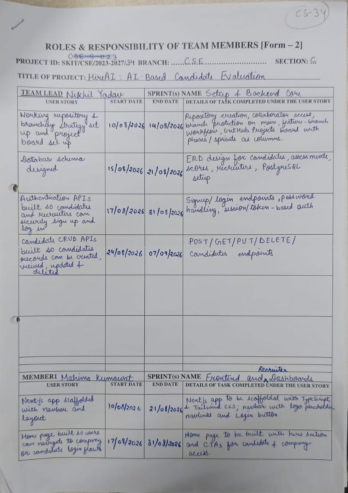
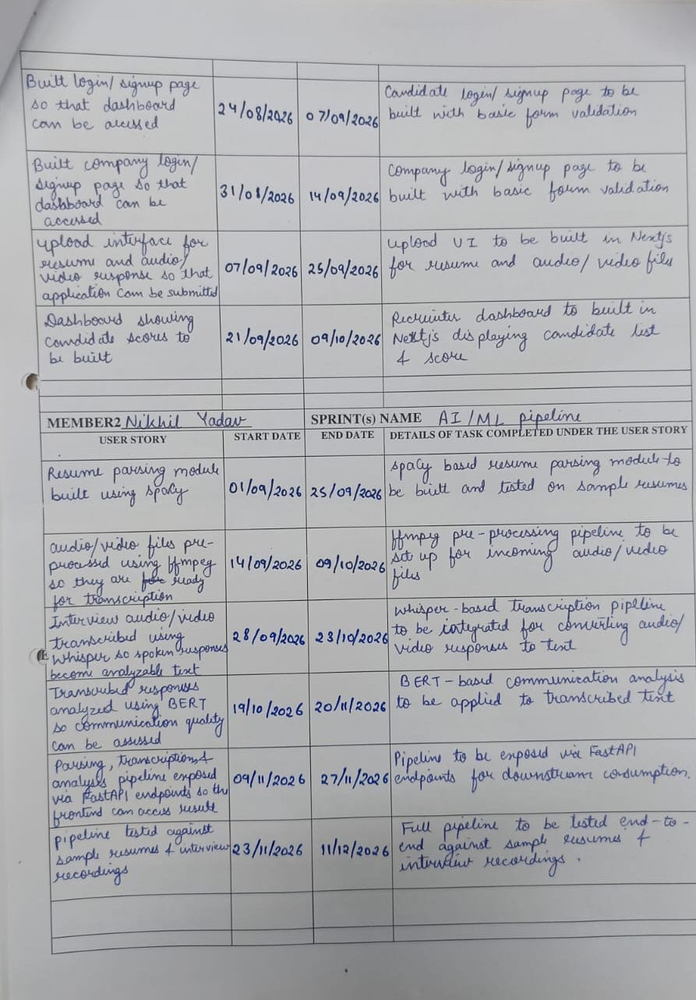
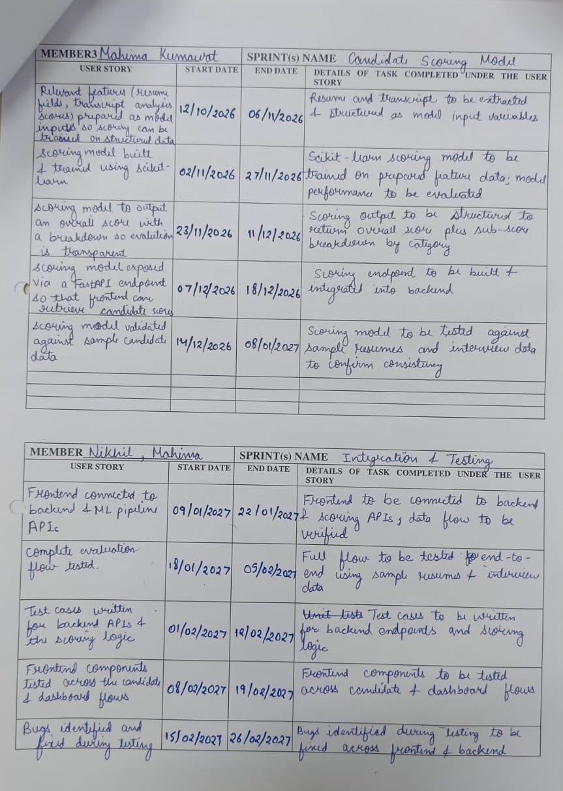
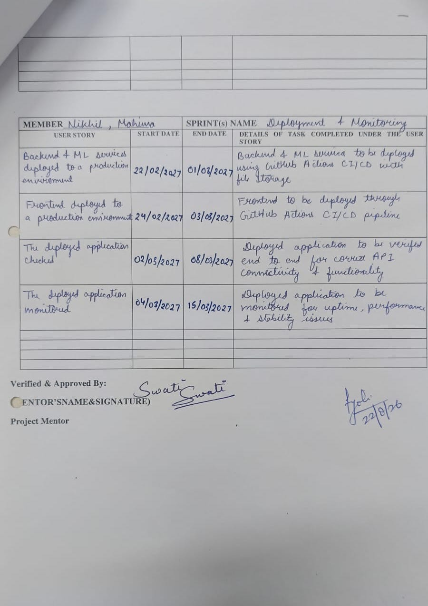

# HireAI

An AI-powered recruitment platform that helps recruiters analyze resumes, match candidates with jobs, and streamline hiring.

## Team

- Team Lead: Nikhil Yadav
- Developer: Mahima Kumawat

## Tech Stack

- React
- Node.js
- Fast API
- Express
- MySQL
- Python (Machine Learning)

## Form - 2

  

  

  

  

