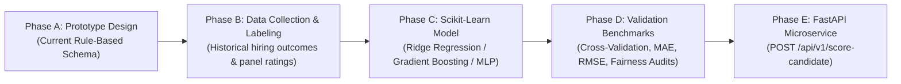

# Candidate Scoring Model Design & Python Prototype Documentation

**Project Title:** HireAI — AI-Based Candidate Evaluation System  
**Assigned Responsibility:** Member 3 – Candidate Scoring Model  
**Artifact Scope:** Initial Isolated Candidate Scoring Model Design, Feature Schema, and Preliminary Python Prototype  
**Status:** Standalone Exploratory Prototype (**Strictly Isolated**; Not Integrated into the HireAI Production Application)

---

## 1. Purpose of the Candidate Scoring Model

In recruitment workflows, evaluating applicants requires synthesizing heterogeneous information sources:
1. Past qualifications and competencies stated on a candidate's resume.
2. Degree of fit between the candidate's profile and specific vacancy requirements (job description).
3. Evaluated performance, correctness, and articulation demonstrated during candidate interviews.

The primary objective of the **Candidate Scoring Model** (Member 3 responsibility) is to consolidate these multi-modal evaluation streams into a normalized, interpretable candidate score on a scale from $0.0$ to $100.0$, accompanied by transparent category-wise breakdowns.

> [!IMPORTANT]
> **Boundary Disclaimer:**  
> This prototype is a **preliminary, rule-based algorithmic design prototype**. It uses standard Python and illustrative engineering weights. It is **not** a trained machine learning model, nor is it wired to live backend databases, resume parsers, or FastAPI endpoints.

---

## 2. Feature Selection & Rationale

Features were selected to capture three essential dimensions of candidate potential without creating premature coupling to incomplete upstream services.

### Feature Mapping Table

| Category | Feature Name | Description | Data Type | Range | Higher is Better? | Source | Default Fallback |
| :--- | :--- | :--- | :--- | :--- | :--- | :--- | :--- |
| **Resume-related** | `skills_relevance` | Depth and relevance of stated technical and domain skills | `float` | $[0.0, 1.0]$ | Yes | Parsed Resume | $0.0$ |
| **Resume-related** | `relevant_experience` | Years and seniority of domain-specific work experience | `float` | $[0.0, 1.0]$ | Yes | Parsed Resume | $0.0$ |
| **Resume-related** | `education_relevance` | Alignment of academic credentials and degree discipline | `float` | $[0.0, 1.0]$ | Yes | Parsed Resume | $0.5$ (neutral baseline) |
| **Job Matching** | `required_skills_matched` | Fraction of mandatory JD skills satisfied by candidate | `float` | $[0.0, 1.0]$ | Yes | JD Comparison | $0.0$ |
| **Job Matching** | `missing_required_skills` | Ratio of missing mandatory skills identified in gap analysis | `float` | $[0.0, 1.0]$ | No (Inverted) | JD Comparison | $1.0$ (penalty) |
| **Job Matching** | `overall_jd_relevance` | Semantic text similarity (e.g., bi-encoder embedding match) | `float` | $[0.0, 1.0]$ | Yes | JD Comparison | $0.0$ |
| **Interview** | `interview_answer_relevance` | Semantic correctness and accuracy of candidate answers | `float` | $[0.0, 1.0]$ | Yes | Interview Analysis | $0.0$ |
| **Interview** | `communication_assessment` | Articulation, structure, conciseness, and clarity | `float` | $[0.0, 1.0]$ | Yes | Interview Analysis | $0.5$ (neutral baseline) |

*Note: These features represent proposed evaluation dimensions. They are not assumed to be already exposed or computed by existing backend modules.*

---

## 3. Preliminary Scoring Methodology & Formulas

The scoring architecture uses a two-tier weighted linear aggregation pipeline:

### 3.1 Sub-Category Calculations

All feature inputs are normalized into $[0.0, 1.0]$ and mapped to a category sub-score scaled to $[0.0, 100.0]$.

1. **Resume Score ($S_{\text{resume}}$):**
   $$S_{\text{resume}} = 100 \times \left(0.45 \cdot f_{\text{skills\_rel}} + 0.40 \cdot f_{\text{exp\_rel}} + 0.15 \cdot f_{\text{edu\_rel}}\right)$$

2. **Job Matching Score ($S_{\text{job}}$):**
   Missing skills are inverted to obtain a retention/coverage score: $f_{\text{retention}} = (1.0 - f_{\text{missing\_req}})$.
   $$S_{\text{job}} = 100 \times \left(0.40 \cdot f_{\text{req\_matched}} + 0.20 \cdot (1.0 - f_{\text{missing\_req}}) + 0.40 \cdot f_{\text{jd\_rel}}\right)$$

3. **Interview Score ($S_{\text{interview}}$):**
   $$S_{\text{interview}} = 100 \times \left(0.65 \cdot f_{\text{ans\_rel}} + 0.35 \cdot f_{\text{comm\_assess}}\right)$$

### 3.2 Overall Candidate Score ($S_{\text{overall}}$)

The final overall score combines the three categories using preliminary illustrative weights:
- Resume Weight ($W_{\text{resume}}$): $0.35$ ($35\%$)
- Job Matching Weight ($W_{\text{job}}$): $0.35$ ($35\%$)
- Interview Weight ($W_{\text{interview}}$): $0.30$ ($30\%$)

$$\text{Overall Candidate Score} = 0.35 \cdot S_{\text{resume}} + 0.35 \cdot S_{\text{job}} + 0.30 \cdot S_{\text{interview}}$$

All scores are strictly clamped to $[0.0, 100.0]$ and rounded to two decimal places.

---

## 4. Handling Missing or Invalid Values

In real recruitment data pipelines, incomplete profiles and partial interview rounds are frequent. The prototype handles edge cases deterministically:
1. **Type Checking & Coercion:** Values are safely cast to `float`. Invalid formats, strings, `NaN`, or `±inf` trigger an automatic fallback.
2. **Range Clamping:** Any value $< 0.0$ is clamped to $0.0$; any value $> 1.0$ is clamped to $1.0$.
3. **Domain-Specific Defaults:**
   - Missing skills or experience fall back to $0.0$ (conservative assumption of absence).
   - Missing required skills penalty falls back to $1.0$ (assuming all required skills missing).
   - Education and communication fall back to $0.5$ (neutral prior avoiding undue penalization for unassessed qualitative fields).
4. **Auditability:** Any substituted fallback is tracked in the candidate result under `fallbacks_applied` to provide complete auditing transparency to hiring reviewers.

---

## 5. Sample Results & Interpretation

The prototype evaluated four clearly synthetic, illustrative candidate profiles:

| Candidate ID | Description | Resume Score (/100) | Job Matching Score (/100) | Interview Score (/100) | Overall Score (/100) | Audit Notes |
| :--- | :--- | :--- | :--- | :--- | :--- | :--- |
| **SYNTH-CAND-001** | Strong Match (Senior) | $89.35$ | $89.60$ | $92.60$ | **$89.92$** | High qualifications across all criteria |
| **SYNTH-CAND-002** | Moderate Match | $66.75$ | $66.20$ | $79.40$ | **$70.36$** | Stronger interview performance elevates score |
| **SYNTH-CAND-003** | Weak Match | $35.25$ | $37.80$ | $45.25$ | **$38.68$** | Significant skill gaps and low JD alignment |
| **SYNTH-CAND-004** | Missing Data Edge Case | $49.50$ | $73.80$ | $72.75$ | **$64.90$** | Fallbacks applied for missing `experience` and `communication` |

### Interpretation
- **SYNTH-CAND-001** validates that high competency across all categories yields an overall score approaching $90$.
- **SYNTH-CAND-002** illustrates balanced weighting where moderate resume alignment is partially compensated by high interview clarity.
- **SYNTH-CAND-003** verifies that poor technical and relevance indicators correctly bound the score into the lower tier ($< 40$).
- **SYNTH-CAND-004** demonstrates graceful degradation: missing fields are safely audited without throwing runtime exceptions.

---

## 6. Limitations of the Prototype

1. **Heuristic Weights:** Category weights ($35\% / 35\% / 30\%$) and sub-feature coefficients are manually designated engineering assumptions, not empirical model coefficients.
2. **No Ground-Truth Calibration:** Because this prototype does not evaluate a labeled historical hiring outcome dataset, no scientific claims of accuracy, precision, recall, MAE, or RMSE can be made.
3. **Linearity Assumption:** The model assumes additive linear relationships between features, whereas real hiring decisions often exhibit non-linear interactions (e.g., hard prerequisite constraints).
4. **Simulated Inputs:** Feature inputs represent clean synthetic floats rather than live outputs from upstream NLP parsers.

---

## 7. Future Roadmap: Scikit-Learn Training & FastAPI Serving

Once the upstream pipeline components are validated and labeled training data is acquired, the scoring architecture will evolve according to the following phased roadmap:

1. **Dataset Assembly:** Assemble historical candidate profiles with multi-annotator consensus ratings or interview panel outcomes.
2. **Supervised Model Training:** Train scikit-learn regressors (e.g., `Ridge`, `GradientBoostingRegressor`, or `RandomForestRegressor`) to learn optimal feature coefficients rather than manual heuristics.
3. **Fairness & Bias Auditing:** Conduct demographic parity and adverse impact ratio evaluations across gender and demographic identifiers.
4. **FastAPI Exposing:** Package the fitted pipeline into a lightweight inference service providing typed Pydantic input models, Swagger docs, and JSON responses.

